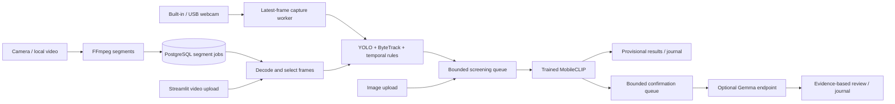

# Scene review application

Minimal upload/live-camera application and camera backend for five anomaly objectives:
smoking, littering, loitering, apparent public sleeping, and unattended items.
MobileCLIP2-S2 screens evidence on CPU. An optional separately served Gemma
model reviews the same evidence asynchronously.

This branch contains application and inference code, database migrations,
deployment instructions, and focused runtime checks. Model training, dataset
downloads, evaluation notebooks, and research reports remain on their original
branches. Large weights and generated media are excluded from Git.



## One-command setup

With Python 3.12 on an x86_64 Linux machine, transfer the model archive and run:

```bash
python3.12 deploy.py setup --bundle /path/to/capstone-mobileclip2-s2-cpu-20261103.tar.gz
python3.12 deploy.py start
```

Open `http://localhost:8501`. Setup creates `.venv`, installs the CPU packages,
verifies/imports weights, creates configuration if absent, and runs real CPU
classifier/tracker checks. It preserves existing configuration/models and can
be rerun after a failed step. Startup does not install anything. A repeat setup
without `--bundle` works once model files have been verified/imported.

For camera support, install FFmpeg and use `setup --with-camera`; the tool
starts the existing local PostgreSQL Compose service unless an external
`DATABASE_URL` is configured, and applies migrations. Gemma stays optional:
`setup --gemma-url http://server:8080/v1` configures a separately served model.
See [deployment commands, prerequisites and recovery](docs/deployment.md).

## Manual install

Use Python 3.12 and run these commands from this checkout. Camera recording
also needs `ffmpeg` on `PATH` and PostgreSQL. File uploads do not need PostgreSQL.

```bash
python3.12 -m venv .venv
source .venv/bin/activate
python -m pip install --upgrade pip
python -m pip install torch==2.8.0+cpu torchvision==0.23.0+cpu --index-url https://download.pytorch.org/whl/cpu
python -m pip install -r requirements.txt
python -m pip install -e . --no-deps
cp .env.example .env
```

Dependencies are pinned to the validated CPU environment. The application uses
local model files and disables automatic model downloading. Keep the checkout
available when running the application; the camera backend is under
`data-pipeline/` and shares this Python environment.

## Import trained models

Transfer the existing `capstone-mobileclip2-s2-cpu-20261103.tar.gz` archive
separately, verify its checksum sidecar, then import only its required weights:

```bash
python tools/import_models.py /path/to/capstone-mobileclip2-s2-cpu-20261103.tar.gz
```

The standard-library importer copies 15 explicitly mapped assets into
`models/`, verifies each against the transfer manifest, checks the trained
anomaly definitions, and rejects an existing destination. It does not import
the archive's research code or extract arbitrary paths. See
[model sources and licenses](docs/model_sources.md).

For an existing shared model directory, set `VISION_MODELS_DIR` in `.env`.
Relative paths resolve against this checkout. The default layout is:

```text
models/
  manifest.json
  mobileclip2-s2/
    base/                  # local OpenCLIP config, weights and tokenizer
    selected_heads.pt
    finetuned_best.pt
    frozen_policies.json
    state.json
    provenance.json
  detectors/
    yolo26s.pt
    yolo26s-pose.pt
    fasterrcnn_resnet50_fpn_v2_coco-dd69338a.pth
```

Small fitted tracking checks live in `vision_runtime/tracking/weights/` and
are included in this branch. SigLIP2 inference is supported by the backend,
but needs its corresponding trained assets; the importer supplies MobileCLIP.

## Upload interface

```bash
python -m streamlit run app.py
```

Open `http://localhost:8501`, upload one image or video, and choose **Analyze
file**. The UI shows provisional signals, supporting frames and raw scores,
and downloads a JSON report. Single images bypass tracking; temporal objectives
remain unknown when their required history is absent.

To enable background Gemma confirmation, serve a compatible vision model
separately and configure its OpenAI-compatible endpoint, including `/v1`:

```dotenv
GEMMA_BASE_URL=http://127.0.0.1:8080/v1
GEMMA_MODEL=gemma4-26b-a4b
```

Restart Streamlit after changing configuration. The server must support image
messages and JSON-schema responses. Optional `GEMMA_API_KEY` authenticates
requests. Gemma inference runs wherever that endpoint is hosted; it may be a
separate GPU machine. Without an endpoint, the application runs on CPU and
does not attempt to load Gemma. Gemma receives selected frames and timestamps,
not the entire encoded video. When enabled, uploaded evidence is sent to that
configured endpoint.

Provisional results remain visible while Gemma runs. Disagreement, missing
history, malformed output, overflow, and timeout are explicit review/unknown
states. No external alert delivery is implemented. Scores are raw classifier
outputs, not probabilities.

## Camera backend

### Built-in or USB camera in Streamlit

Start the normal application with `python3.12 deploy.py start`, select **Live
camera**, choose a camera index (usually **0**, or **1/2** for a USB device), and
select **Start camera**. **Stop camera** releases capture while in-flight model
work finishes. **Clear camera** also discards its temporary evidence. Switching
back to uploads stops capture. There is no extra Python dependency or database
requirement for a local webcam.

The camera must be attached to the **machine running Streamlit**. A remote
browser does not capture its own webcam through this interface. Permit camera
access in the operating system and close applications holding the device.
Resolution is requested at 640 × 480; the driver may choose another supported
resolution. Camera hardware was not available on the development host; simulated
capture and a paced video fixture exercise lifecycle and real-model inference.

Capture and preview are independent of tracking/classification. Tracking selects
up to 5 FPS from a single latest-frame slot, using actual host monotonic read
timestamps. Periodic scene review defaults to 3 seconds, alongside rule-triggered
events. The screening queue keeps at most one waiting candidate, replacing it
with newer live evidence during overload. Skipped windows remain explicit.
Gemma, when configured, runs through the same separate confirmation queue.

The view shows tracking lag and scored-evidence age. Live signals use the most
recent completed window per objective. It keeps the newest 30 evidence windows
plus in-flight work, compacts its rolling journal and deletes retired event
images only after screening/confirmation releases them. No full video is
recorded. A live view that stops polling for about 20 seconds stops capture and
discards temporary evidence; uninterruptible driver calls can delay release.
This path does not establish a two-second anomaly-detection guarantee.

### RTSP and recorded-segment backend

Use the same activated root environment. Start a database, configure
`DATABASE_URL`, and apply the retained migrations:

```bash
docker compose -f data-pipeline/infra/compose.yaml up -d --wait postgres
cd data-pipeline
python -m alembic upgrade head
cd ..
python data-pipeline/main.py --video /path/to/video.mp4 --source-id camera_01
```

For a camera:

```bash
python data-pipeline/main.py --source rtsp --rtsp-url rtsp://camera-address/stream --source-id camera_01
```

`DATABASE_URL` may be in root `.env`, backend `.env`, or the environment.
The backend supports `--record-only`, `--model`, `--device`, `--target-fps`,
`--segment-seconds`, `--recordings-dir`, `--out`, `--gemma-url`, and
`--gemma-model`. Defaults are the November ensemble classifier on CPU, 5 selected frames/second,
2-second target segments, and a 10-second periodic scene scan in addition to
rule-triggered events. FFmpeg keyframes can make actual segments longer.
The CLI writes camera evidence and `events.jsonl` under `runtime/cameras/`.
Every window the screening classifier calls an anomaly also becomes an
**incident** in PostgreSQL, with a short evidence clip and thumbnail under
`<recordings>/evidence/`; `--no-incidents` turns this off.
Streamlit's local webcam view is independent of this backend.

### Dashboard (React) and incidents API

The React dashboard in `frontend/` reads those incidents through the API in
`data-pipeline/data_pipeline/api`. With the database running and migrated:

```bash
# Terminal 1: API on http://127.0.0.1:8000 (docs at /docs)
cd data-pipeline
python -m uvicorn data_pipeline.api.app:create_app --factory --port 8000

# Terminal 2: dashboard on http://localhost:5173
cd frontend
npm install
npm run dev

# Terminal 3: process a video or camera; incidents appear as they are found
python data-pipeline/main.py --video /path/to/video.mp4 --source-id camera_01
```

One command does the same without Node.js once the dashboard is built
(`npm run build` in `frontend/`, already done in a transfer bundle). It serves
the API and dashboard on port 8000, runs the camera backend, and starts the
bundled CPU Gemma server when one is configured:

```bash
python3.12 deploy.py start --dashboard --camera --video /path/to/video.mp4 --source-id camera_01
```

Then open `http://localhost:8000/staff/home`. For a self-contained folder to
copy to another machine, see
[the transfer bundle](docs/deployment.md#transfer-bundle-and-full-start-13-november-2026).

With the development servers above, open `http://localhost:5173/staff/home`. The review queue, review history and
search pages show live incidents, their evidence clip, the screening score
and, when Gemma is configured, its verdict and a short description of the
scene. Gemma reviews only windows the screening classifier flagged.
`python deploy.py calibrate --source-id <camera>` raises one camera's
screening thresholds on its own ordinary footage when it keeps raising the
same false alarm ([how and when](docs/START_HERE.md)).
The dev server proxies `/api` to the API (`VITE_API_PROXY` overrides the
address). Set `RECORDINGS_DIR` for the API if `--recordings-dir` was used.
While the API is not running, the pages fall back to built-in demo data.

Not connected yet: login, Accept/Dismiss/Escalate (the review endpoint is not
implemented), cameras, rules, hotspots and reports still show demo data. See
[the integration notes](docs/integration.md#dashboard-integration-13-november-2026).

See [backend operations](data-pipeline/README.md) and the
[integration audit, state transitions, and validation](docs/integration.md).
Segment jobs survive restarts, but there is no automatic recovery of a job
left `processing`; AI queues are in memory and also need a replay mechanism
before unattended crash recovery is claimed. The current CPU path does not
establish a two-second end-to-end alert guarantee.

## Development checks

```bash
python -m pip install -r requirements-dev.txt
ruff check .
ruff format --check .
pytest tests -q
```

To include PostgreSQL backend tests, set `TEST_DATABASE_URL` to a disposable
database and run `pytest -q`. Tests exercise application contracts and backend
behavior without downloading models. Real model and browser checks for this
integration are described in [the audit](docs/integration.md).
