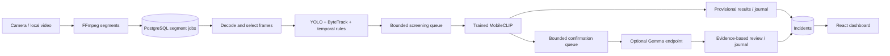

# Scene review application

Camera backend and review dashboard for five anomaly objectives:
smoking, littering, loitering, apparent public sleeping, and unattended items.
MobileCLIP2-S2 screens evidence on CPU. An optional separately served Gemma
model reviews the same evidence asynchronously.

This branch contains application and inference code, database migrations,
deployment instructions, and focused runtime checks. Model training, dataset
downloads, evaluation notebooks, and research reports remain on their original
branches. Large weights and generated media are excluded from Git.



## One-command setup

With Python 3.12 on an x86_64 Linux machine, transfer the model archive and run:

```bash
python3.12 deploy.py setup --bundle /path/to/capstone-mobileclip2-s2-cpu-20261103.tar.gz
python3.12 deploy.py create-admin --name "Admin" --email you@example.com --staff-id S001
python3.12 deploy.py start
```

Open `http://localhost:8000/login` and sign in with that email and the password
`create-admin` asked for (once is enough; admins add staff from the dashboard).
Setup creates `.venv`, installs the CPU
packages, verifies/imports weights, creates configuration if absent, runs real
CPU classifier/tracker checks, and prepares the database: it starts the local
PostgreSQL Compose service unless an external `DATABASE_URL` is configured, and
applies migrations, including the login and staff-account tables. It preserves existing configuration/models and can be rerun
after a failed step. Startup does not install anything. A repeat setup without
`--bundle` works once model files have been verified/imported. The dashboard
must be built (`npm run build` in `frontend/`, already done in a transfer bundle).

The models are optional. Without them (`setup` with no `--bundle`, or an empty
`VISION_MODELS_DIR`), setup, `check` and `start` print a warning and carry on:
the dashboard and API run, and a camera backend records but does not screen,
so no new incidents are opened. Import the models later and restart.

For camera support, install FFmpeg and use `setup --with-camera`. Gemma stays optional:
`setup --gemma-url http://server:8080/v1` configures a separately served model.
See [deployment commands, prerequisites and recovery](docs/deployment.md).

## Manual install

Use Python 3.12 and run these commands from this checkout. The dashboard needs
PostgreSQL with the `pgvector` extension; camera recording also needs `ffmpeg`
on `PATH`.

```bash
python3.12 -m venv .venv
source .venv/bin/activate
python -m pip install --upgrade pip
python -m pip install torch==2.8.0+cpu torchvision==0.23.0+cpu --index-url https://download.pytorch.org/whl/cpu
python -m pip install -r requirements.txt
python -m pip install -e . --no-deps
cp .env.example .env
```

Dependencies are pinned to the validated CPU environment. The application uses
local model files and disables automatic model downloading. Keep the checkout
available when running the application; the camera backend is under
`data-pipeline/` and shares this Python environment.

## Import trained models

Transfer the existing `capstone-mobileclip2-s2-cpu-20261103.tar.gz` archive
separately, verify its checksum sidecar, then import only its required weights:

```bash
python tools/import_models.py /path/to/capstone-mobileclip2-s2-cpu-20261103.tar.gz
```

The standard-library importer copies 15 explicitly mapped assets into
`models/`, verifies each against the transfer manifest, checks the trained
anomaly definitions, and rejects an existing destination. It does not import
the archive's research code or extract arbitrary paths. See
[model sources and licenses](docs/model_sources.md).

For an existing shared model directory, set `VISION_MODELS_DIR` in `.env`.
Relative paths resolve against this checkout. The default layout is:

```text
models/
  manifest.json
  mobileclip2-s2/
    base/                  # local OpenCLIP config, weights and tokenizer
    selected_heads.pt
    finetuned_best.pt
    frozen_policies.json
    state.json
    provenance.json
  detectors/
    yolo26s.pt
    yolo26s-pose.pt
    fasterrcnn_resnet50_fpn_v2_coco-dd69338a.pth
```

Small fitted tracking checks live in `vision_runtime/tracking/weights/` and
are included in this branch. SigLIP2 inference is supported by the backend,
but needs its corresponding trained assets; the importer supplies MobileCLIP.

## Gemma confirmation

To enable background Gemma confirmation, serve a compatible vision model
separately and configure its OpenAI-compatible endpoint, including `/v1`:

```dotenv
GEMMA_BASE_URL=http://127.0.0.1:8080/v1
GEMMA_MODEL=gemma4-26b-a4b
```

Restart the camera backend after changing configuration. The server must
support image messages and JSON-schema responses. Optional `GEMMA_API_KEY`
authenticates requests. Gemma inference runs wherever that endpoint is hosted;
it may be a separate GPU machine. Without an endpoint, the application runs on
CPU and does not attempt to load Gemma. Gemma receives selected frames and
timestamps, not the entire encoded video. When enabled, camera evidence is
sent to that configured endpoint.

Disagreement, missing history, malformed output, overflow, and timeout are
explicit review/unknown states. No external alert delivery is implemented.
Scores are raw classifier outputs, not probabilities.

The Streamlit upload and local-webcam page was retired on 20 November 2026;
the dashboard is the application. Its upload and webcam services remain in
`vision_runtime/review.py` and `vision_runtime/live.py` (with their tests) for
a future dashboard upload page; the page itself is in Git history at `d2672fd`.

## Camera backend

### RTSP and recorded-segment backend

Use the same activated root environment. Start a database, configure
`DATABASE_URL`, and apply the retained migrations:

```bash
docker compose -f data-pipeline/infra/compose.yaml up -d --wait postgres
cd data-pipeline
python -m alembic upgrade head
cd ..
python data-pipeline/main.py --video /path/to/video.mp4 --source-id camera_01
```

For a camera:

```bash
python data-pipeline/main.py --source rtsp --rtsp-url rtsp://camera-address/stream --source-id camera_01
```

`DATABASE_URL` may be in root `.env`, backend `.env`, or the environment.
The backend supports `--record-only`, `--model`, `--device`, `--target-fps`,
`--segment-seconds`, `--recordings-dir`, `--out`, `--gemma-url`, and
`--gemma-model`. Defaults are the November ensemble classifier on CPU, 5 selected frames/second,
2-second target segments, and a 10-second periodic scene scan in addition to
rule-triggered events. FFmpeg keyframes can make actual segments longer.
The CLI writes camera evidence and `events.jsonl` under `runtime/cameras/`.
Every window the screening classifier calls an anomaly also becomes an
**incident** in PostgreSQL, with a short evidence clip and thumbnail under
`<recordings>/evidence/`; `--no-incidents` turns this off. Without installed
models the backend logs a warning and records only, as with `--record-only`.

### Dashboard (React) and incidents API

The React dashboard in `frontend/` reads those incidents through the API in
`data-pipeline/data_pipeline/api`. With the database running and migrated:

```bash
# Terminal 1: API on http://127.0.0.1:8000 (docs at /docs)
cd data-pipeline
python -m uvicorn data_pipeline.api.app:create_app --factory --port 8000

# Terminal 2: dashboard on http://localhost:5173
cd frontend
npm install
npm run dev

# Terminal 3: process a video or camera; incidents appear as they are found
python data-pipeline/main.py --video /path/to/video.mp4 --source-id camera_01
```

One command does the same without Node.js once the dashboard is built
(`npm run build` in `frontend/`, already done in a transfer bundle). It serves
the API, the login and account routes and the dashboard from one process on
port 8000, runs the camera backend, and starts the bundled CPU review model
server when one is configured (Qwen 3.5-4B by default; its settings still say
"Gemma"), supervising them all until Ctrl+C:

```bash
python3.12 deploy.py start --dashboard --camera --video /path/to/video.mp4 --source-id camera_01
```

`python3.12 deploy.py start` alone serves the API, login and dashboard. Then open `http://localhost:8000/login`
(the first admin comes from `deploy.py create-admin`). For a self-contained folder to
copy to another machine, see
[the transfer bundle](docs/deployment.md#transfer-bundle-and-full-start-13-november-2026).

With the development servers above, open `http://localhost:5173/login`. The review queue, review history and
search pages show live incidents, their evidence clip, the screening score
and, when Gemma is configured, its verdict and a short description of the
scene. Gemma reviews only windows the screening classifier flagged.
`python deploy.py calibrate --source-id <camera>` raises one camera's
screening thresholds on its own ordinary footage when it keeps raising the
same false alarm ([how and when](docs/START_HERE.md)).
The dev server proxies `/api` to the API (`VITE_API_PROXY` overrides the
address). Set `RECORDINGS_DIR` for the API if `--recordings-dir` was used.
While the API is not running, the pages fall back to built-in demo data.

Login, invites and set-password are the routes of the accounts backend in
`cayla-backend/`, mounted on the same API (`/api/v1/auth`, `/me`, `/users`,
`/audit-log`) and stored in the same database (migration `e7b3c9a41f02`). Every
incidents and reviews route needs a signed-in session, and reviews are saved
under the signed-in user's id. Signed-out visitors to a dashboard page are sent
to `/login`, and staff opening an admin page to their own home page. Create the
first admin with `deploy.py create-admin`, or in development with
`python -m scripts.create_admin ...` from `cayla-backend/`, which reads
`DATABASE_URL` from the same `.env` files. On plain HTTP away from localhost,
`COOKIE_SECURE=false` (which setup writes to `.env`) is needed for the login
cookie; set it to `true` behind HTTPS. Cameras, rules, hotspots, workload and
the admin home page still show demo data. See
[the integration notes](docs/integration.md#update-20-november-2026-what-is-still-not-connected).

See [backend operations](data-pipeline/README.md) and the
[integration audit, state transitions, and validation](docs/integration.md).
Segment jobs survive restarts, but there is no automatic recovery of a job
left `processing`; AI queues are in memory and also need a replay mechanism
before unattended crash recovery is claimed. The current CPU path does not
establish a two-second end-to-end alert guarantee.

## Development checks

```bash
python -m pip install -r requirements-dev.txt
ruff check .
ruff format --check .
pytest tests -q
```

To include PostgreSQL backend tests, set `TEST_DATABASE_URL` to a disposable
database and run `pytest -q`. Tests exercise application contracts and backend
behavior without downloading models. Real model and browser checks for this
integration are described in [the audit](docs/integration.md).
