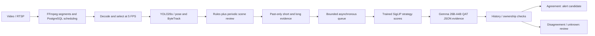

# Stage 1 integration and evidence confirmation

The integrated path is `data-pipeline/main.py` for recording/database scheduling or
`data-pipeline/stage1_offline.py` for direct video processing. Both use the same
detector, causal evidence windows, resident model workers and asynchronous queue.



## Which model to use

Use **SigLIP2-B/16-224 with its selected trained strategy** for the primary
classifier. It leads the existing ten-source, 3,792-case retrospective comparison
at macro AP 0.7911; MobileCLIP2-S2 is the smaller alternative at 0.7572. These
aggregate figures describe the historical scene/window protocols, not the new
continuous tracker workflow. Historical threshold transfer has substantial
failures, especially for unattended objects.

Use **Gemma 4 26B-A4B, official QAT Q4_0 GGUF**, for GPU evidence confirmation in
this prototype. Its sparse decoder and native llama.cpp JSON constraints were
more useful here than selecting a smaller dense model on binary prefill speed.
12B has stronger earlier optimized ranking quality than 26B, but its current
native prompt-only structured responses need more validation; E4B also exhibits
format failures. See the dated integration report for measured request times and
rejected iterations. This is a workstation-specific recommendation; CPU and
multi-camera capacity are separate questions.

For a CPU-only transfer, use the trained MobileCLIP2-S2 bundle and the
[CPU packaging and deployment guide](cpu_deployment.md). Its launcher explicitly
sets both model devices to CPU and uses a portable offline model cache. It
packages the existing implementation; the two-second target remains unmet.

## Run from this checkout

The ingestion runtime requires Python 3.12, FFmpeg and PostgreSQL for the database
path. Install its optional detector dependencies with `uv sync --extra stage1`
inside `data-pipeline/`. Keep the existing CLIP and Gemma model environments
separate: the measured environments use different Transformers versions.

Required local artifacts are:

- `data/models/stage1/yolo26s.pt` and `yolo26s-pose.pt` from the official
  [Ultralytics assets](https://github.com/ultralytics/assets) release. The installed
  versions/hashes are recorded in `data/models/stage1/acquisition_20261103.json`.
- The existing selected CLIP bundle in `results/strategy_study_20261016/`, its
  pretrained encoder, prior interpolation checkpoint and reference detector.
- A pinned Gemma checkpoint receipt under `results/gemma4_evaluation_20261027/`.
  GGUF variants also need the pinned llama.cpp runtime in
  `anomaly_eval/config/gemma4_runtime.json`. Receipt paths must exist locally.

Example, using the isolated runtimes already available on this workstation:

```bash
export LD_LIBRARY_PATH="$PWD/data/tools/stage1_cuda_driver${LD_LIBRARY_PATH:+:$LD_LIBRARY_PATH}"
export YOLO_CONFIG_DIR="$PWD/data/tools/stage1_runtime_config"
export YOLO_AUTOINSTALL=false
.venv-stage1/bin/python data-pipeline/stage1_offline.py VIDEO.mp4 \
  --vlm cascade --clip-model siglip2-b16-224 \
  --vlm-model gemma4-26b-a4b --safety-scan-seconds 10 \
  --clip-python "$PWD/.venv-gpu/bin/python" \
  --vlm-python "$PWD/.venv-gemma4/bin/python" \
  --stage1-device cuda:0 --out results/my_integration_run
```

For the database path, migrate the intended development database using
`python -m alembic upgrade head` from `data-pipeline/`, then run:

```bash
.venv-stage1/bin/python data-pipeline/main.py \
  --source file --video VIDEO.mp4 --stage1 --vlm cascade \
  --safety-scan-seconds 10 --segment-seconds 2 \
  --candidate-dir "$PWD/results/my_live_candidates" \
  --recordings-dir "$PWD/results/my_live_recordings"
```

Set `DATABASE_URL` explicitly for that database. The integration tests used a
private disposable PostgreSQL instance. File recording uses FFmpeg `-re`, so it
is paced like an arriving source. Direct offline video processing is unpaced.
For RTSP use `--source rtsp --rtsp-url URL`; no external RTSP camera was tested.
Actual segment duration depends on source keyframes even with a two-second
segment target. Segmentation delays precede the measured candidate queue time.

`--vlm clip` runs only the trained classifier. `--vlm gemma` runs only evidence
confirmation. `--vlm none` records candidates without inference. The old CLI
name `--vlm predict-clip` now selects the resident strategy worker; the old
per-request subprocess classes are retained only for compatibility.

On this workstation the loaded NVIDIA driver and system userspace versions
differ. GPU tests used a local directory containing matching **CUDA driver
libraries only** via `LD_LIBRARY_PATH`. Adding the entire extracted NVIDIA
graphics directory to the ingestion process breaks system FFmpeg's OpenGL
loading. The GGUF launcher manages its own runtime libraries. This workaround
does not require changing system drivers or the original evaluation environments.

## Evidence and decision policy

- Models remain loaded for the run; imports and diagnostic logs go to stderr,
  while the worker protocol is request-ID-bound JSON lines.
- The frame callback saves evidence and queues work; it does not wait for model
  inference. Pending capacity defaults to 16. Full queues produce an explicit
  `not_run` rejection; inference errors and malformed answers become `unknown`.
- A periodic whole-scene review runs every ten observed seconds by default,
  independent of rule triggers. `--safety-scan-seconds 0` reproduces rule-only
  gating. This closes a demonstrated blind spot but increases request load;
  it does not establish a gate recall guarantee.
  A five-second interval exceeded the measured processing capacity on the
  high-resolution IWDD example (roughly 6.9 seconds per cascade request); choose
  intervals from measured load and retain the queue rejection audit.
- Candidates contain actual past frames only: a four-second action window and
  a twenty-second context window. Gemma uses up to eight/four chronological
  views respectively, plus a same-time target crop for tracked candidates.
  Whole-scene reviews do not pretend to have a tracked target crop.
  Periodic action windows cover at least the entire review interval, avoiding
  unobserved gaps between scene reviews; they still contain at most eight
  selected action views. Rule-triggered action windows remain four seconds.
- Loitering/unattended inputs need at least four observations spanning 19.5
  seconds; this checks the historical input protocol, not a universal event
  duration. Missing owner association blocks positive unattended-item alerts.
  Tracker-inferred ownership, when present, remains a heuristic relationship.
- Prompted answers describe brief visible or missing evidence and reference
  input frame ordinals. They do not expose a hidden reasoning trace. Empty,
  wrong-key, invalid-reference and placeholder responses cannot alert.
- The classifier never prevents a candidate reaching the reasoner. A model
  disagreement, missing evidence or classifier failure requires review and
  suppresses dispatchable `alert`; underlying predictions remain in the audit.
- Tracker state survives segment boundaries. Session changes and significant
  timestamp gaps reset tracking/history; duplicate times are skipped and
  decreasing times are rejected. Timestamps are decoder estimates, not camera
  capture timestamps.

The selected historical SigLIP crop/geometry recipes still run their reference
Faster R-CNN. Reusing YOLO boxes there would change the trained input protocol
and requires a separate development-only adaptation/calibration study. YOLO
and ByteTrack already provide candidate localization and temporal tracks.

## Outputs and reproduction

Use a fresh output directory for each experiment. Per-source `candidates.jsonl`
contains one terminal record per submitted event. `candidate_journal.jsonl`
contains admission and terminal transitions; do not count both as separate
events. Raw model responses, selected views, scores, guards, model receipts and
queue/service timings are retained. `reasoning_summary.json` contains counts,
worker metadata and runtime versions. Offline runs also write an input/code
hash manifest and model-ready/processing timing.

Replay identical saved candidates to compare model service times without
rerunning detection:

```bash
.venv-stage1/bin/python data-pipeline/stage1_offline.py \
  --replay-candidates results/old_run/SOURCE/candidates.jsonl \
  --vlm gemma --vlm-model gemma4-26b-a4b --out results/new_replay
```

Replay intentionally submits a burst; its queue delay is not paced camera
latency. Include service time, queue delay, segmentation, model startup and
observation duration separately when planning camera capacity. New independent
labelled continuous footage is still needed to measure event recall, false
alerts/hour, ownership correctness and worst-case end-to-end delay.
