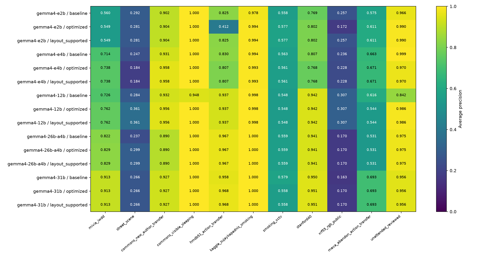
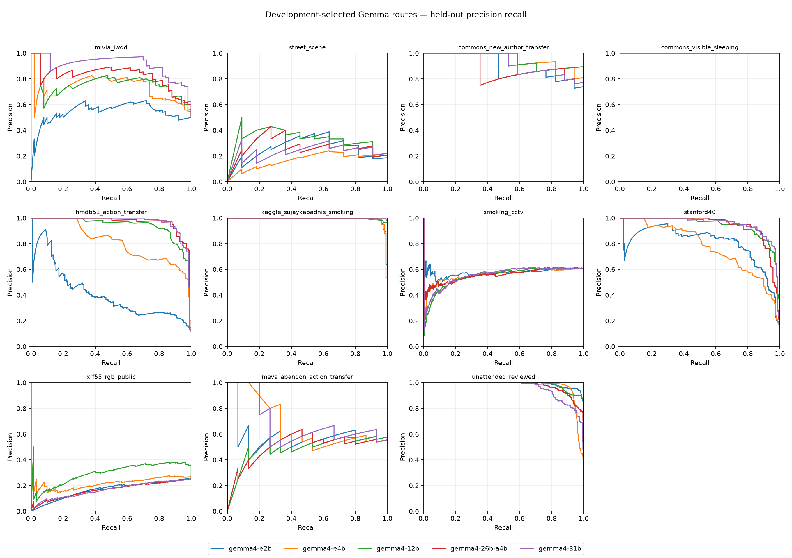
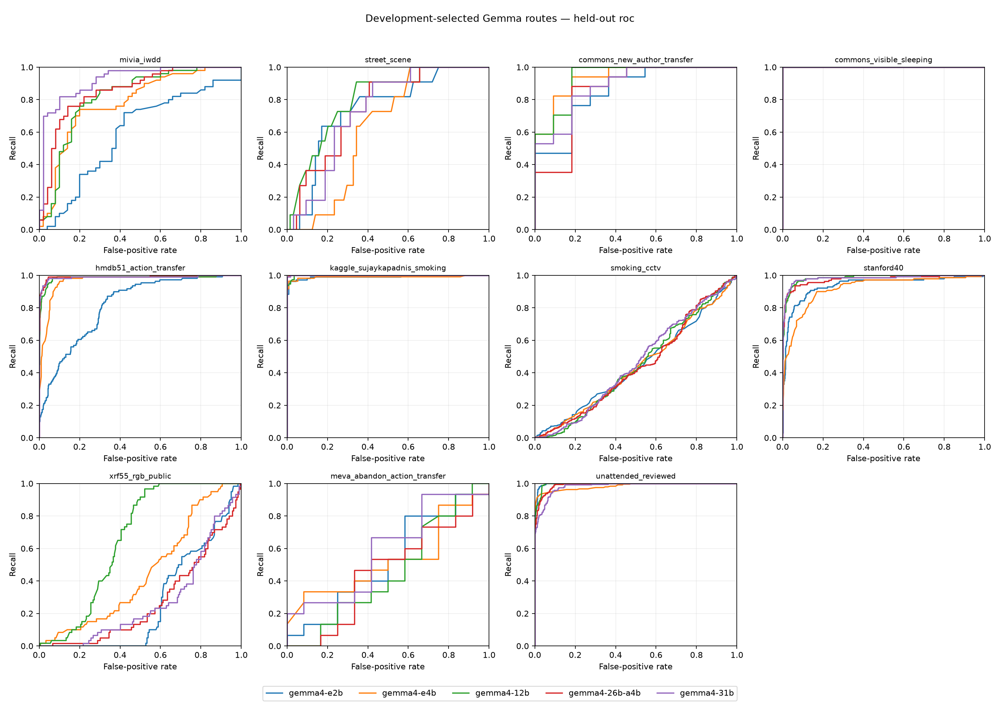

# Gemma 4 five-anomaly evaluation — 27 October 2026

Completed model sizes: **5/5**. Only completed evaluations enter the result tables. Check individual `progress.json`, `run.log` and `suite_status.json` for active or failed work.

## Main findings from the completed study

All five variants completed the same 6,004-case manifest, including 4,032 held-out cases each. The replay audit passed for every model. The highest observed standalone all-source macro AP is **0.7395**, from **gemma4-31b / baseline**. This describes the observed comparison; it is not a test-selected deployment rule.

Prompt and visual-policy optimization improves some models and regresses others. The following deltas preserve the original baseline and development-screen-selected routes. FPR failures and zero recall refer to the optimized route at its frozen every-source development FPR-budget threshold, evaluated on the eleven held-out sources.

| Model | Baseline macro AP | Optimized macro AP | Change | Sources with FPR >5% | Sources with zero recall |
| --- | --- | --- | --- | --- | --- |
| gemma4-e2b | 0.6503 | 0.6347 | -0.0156 | 2/11 | 4/11 |
| gemma4-e4b | 0.6887 | 0.6788 | -0.0099 | 5/11 | 2/11 |
| gemma4-12b | 0.6852 | 0.7224 | +0.0372 | 5/11 | 2/11 |
| gemma4-26b-a4b | 0.6968 | 0.7108 | +0.0140 | 5/11 | 3/11 |
| gemma4-31b | 0.7395 | 0.7394 | -0.0001 | 4/11 | 2/11 |

On the identical ten-source, 3,792-case cohort, the strongest observed standalone Gemma route is gemma4-31b / baseline at **0.7678**, versus **0.7911** for the existing siglip2-b16-224 / dev_selected_strategy pipeline. Gemma therefore does not displace the incumbent on this overall retrospective ranking metric. Individual objectives can favor different models; their source-level results and training/input differences remain essential.

The remaining failures concern generalization and event evidence. All five optimized routes have zero recall on the CCTV smoking cohort at the frozen source-budget operating point. Loitering remains weak. Strong reviewed-unattended AP does not carry over consistently to MEVA abandonment-action windows, which label a different part of the event. High public-sleep AP comes from small provisional visible-sleep cohorts. A development FPR constraint does not guarantee its test counterpart.

The next evaluation should use new camera/session holdouts, representative multi-frame development inputs, explicit duration and owner/item evidence, and continuous event recall plus false alerts/hour. The E2B layout correction is a separately labeled retrospective diagnostic. These results support further validation of task-specific confirmation models; they do not establish a general five-anomaly deployment model.

## Scope and model identities

This is an accuracy study of binary image/clip classification for smoking, littering, loitering, apparent public sleeping and unattended items. It does not benchmark runtime latency, train Gemma weights, or establish complete detector/tracker event performance.

| Model | Pinned repository | Precision / runtime | Weight GB |
| --- | --- | --- | --- |
| gemma4-e2b | [google/gemma-4-E2B-it](https://huggingface.co/google/gemma-4-E2B-it/tree/3e22461f65e89153144f8adb70e3b8c2cc9845a7) | bfloat16 / transformers | 10.25 |
| gemma4-e4b | [google/gemma-4-E4B-it](https://huggingface.co/google/gemma-4-E4B-it/tree/ee0ef6023621cff504d758262d4e04895a5af4a2) | bfloat16 / transformers | 15.99 |
| gemma4-12b | [google/gemma-4-12B-it](https://huggingface.co/google/gemma-4-12B-it/tree/707f0a3b8a3c7ad586ed01e27eafbad8a27dd0f7) | bfloat16 / transformers | 23.92 |
| gemma4-26b-a4b | [google/gemma-4-26B-A4B-it-qat-q4_0-gguf](https://huggingface.co/google/gemma-4-26B-A4B-it-qat-q4_0-gguf/tree/d1c082be9cf3c8a514acf63b8761f4b41935842e) | QAT_Q4_0 / llama.cpp | 15.63 |
| gemma4-31b | [google/gemma-4-31B-it-qat-q4_0-gguf](https://huggingface.co/google/gemma-4-31B-it-qat-q4_0-gguf/tree/59dde24573e7e61570dba08b18a2e1fe246955ed) | QAT_Q4_0 / llama.cpp | 18.85 |

E2B/E4B/12B use native BF16 Transformers. The 26B mixture-of-experts and dense 31B use official Google QAT Q4_0 weights on the 32 GB GPU. Precision, runtime, architecture and model size therefore change together. All downloaded weight files are checked against pinned publisher SHA-256 values; checkpoint receipts record exact revisions. Models are inference-only with thinking disabled.

## Data and development-only optimization

The frozen manifest contains **6,004 non-training cases**, referencing **20,331 distinct image views**; the fixed eight-view selection actually consumes **17,131 distinct source views** before model resizing/contact-sheet construction. Main development has 1,812 cases; XRF source development has 160; the held-out comparison has 4,032. Prior training partitions are used only to check source-group and decoded-pixel separation. No Gemma fitting uses training or test labels.

| Cohort / split | Cases | Positives |
| --- | --- | --- |
| additional_transfer / external | 961 | 141 |
| main / dev | 1812 | 735 |
| main / external | 806 | 140 |
| main / test | 2025 | 814 |
| xrf55 / dev | 160 | 40 |
| xrf55 / test | 240 | 60 |

`dataset_counts.csv` supplies every source/task/split denominator, positive count, negative count, group count and image count. Only the annotated objective is evaluated; unannotated objectives are not negative labels. Up to eight uniformly selected chronological views are retained, without inventing elapsed duration. XRF55’s original sixteen-view examples are uniformly subsampled to eight.

Four predeclared policies compare the existing definition at 280 visual tokens/image, evidence/confuser guidance at 280 or 560 tokens/image, and a numbered chronological contact sheet at 1,120 tokens/sheet. A deterministic primary-development screen (274 cases, source/class/group balanced, at most 64/task) chooses each task’s mean-source AP winner; ties keep the simpler baseline. Full development then calibrates both baseline and optimized methods before any test forward pass. XRF source development calibrates only a secondary threshold; it cannot select the primary prompt route.

The score is the real first-answer Yes-minus-No logit margin. Native BF16 mixed-length tensor batches showed answer-margin drift in preflight, so both backends use canonical single-example forwards without deliberate pacing. GPU inference remains unrestricted. Native Yes+No probability mass is saved. For GGUF, equal +100 label biases expose both labels in post-sampling probabilities with temperature 1 and no truncation/penalties; their log-probability difference cancels the common bias. Development preflight verifies +50/+100 bias invariance before accepting scores.

Operating points are raw zero, maximum development F1, pooled development FPR ≤5%, and a single global threshold meeting ≤5% empirical FPR in every primary-development source. Test FPR can exceed that budget. Raw zero for a development-standardized ensemble is merely a centered-score control, not an uncalibrated Yes/No decision.

## Results

| Model | Method | Main macro AP | All-source macro AP | smoking | littering | loitering | rough_sleeping | unattended_items |
| --- | --- | --- | --- | --- | --- | --- | --- | --- |
| gemma4-e2b | baseline | 0.7175 | 0.6503 | 0.6775 | 0.5605 | 0.2921 | 0.9509 | 0.7706 |
| gemma4-e2b | optimized | 0.7221 | 0.6347 | 0.5912 | 0.5486 | 0.2808 | 0.9522 | 0.8009 |
| gemma4-e2b | layout_supported | 0.7221 | 0.6546 | 0.6908 | 0.5486 | 0.2808 | 0.9522 | 0.8009 |
| gemma4-e4b | baseline | 0.7495 | 0.6887 | 0.6857 | 0.7144 | 0.2470 | 0.9656 | 0.8309 |
| gemma4-e4b | optimized | 0.7334 | 0.6788 | 0.6712 | 0.7385 | 0.1844 | 0.9791 | 0.8208 |
| gemma4-e4b | layout_supported | 0.7334 | 0.6788 | 0.6712 | 0.7385 | 0.1844 | 0.9791 | 0.8208 |
| gemma4-12b | baseline | 0.7260 | 0.6852 | 0.7467 | 0.7259 | 0.2843 | 0.9401 | 0.7291 |
| gemma4-12b | optimized | 0.7876 | 0.7224 | 0.7467 | 0.7617 | 0.3609 | 0.9779 | 0.7651 |
| gemma4-12b | layout_supported | 0.7876 | 0.7224 | 0.7467 | 0.7617 | 0.3609 | 0.9779 | 0.7651 |
| gemma4-26b-a4b | baseline | 0.7734 | 0.6968 | 0.7272 | 0.8221 | 0.2366 | 0.9450 | 0.7531 |
| gemma4-26b-a4b | optimized | 0.7874 | 0.7108 | 0.7272 | 0.8294 | 0.2995 | 0.9450 | 0.7531 |
| gemma4-26b-a4b | layout_supported | 0.7874 | 0.7108 | 0.7272 | 0.8294 | 0.2995 | 0.9450 | 0.7531 |
| gemma4-31b | baseline | 0.7957 | 0.7395 | 0.7299 | 0.9131 | 0.2662 | 0.9635 | 0.8248 |
| gemma4-31b | optimized | 0.7944 | 0.7394 | 0.7294 | 0.9131 | 0.2662 | 0.9635 | 0.8248 |
| gemma4-31b | layout_supported | 0.7944 | 0.7394 | 0.7294 | 0.9131 | 0.2662 | 0.9635 | 0.8248 |

Macro AP first averages sources within each task, then weights the five tasks equally. Main macro excludes additional transfer and XRF; all-source macro includes them, including the weak XRF proxy. AP is ranking performance, not classification accuracy. Compare it with each source’s positive fraction (the constant-score AP reference), and inspect operating-point metrics.

## Selected routes and source-level operating performance

| Model | Task | Development-selected policy |
| --- | --- | --- |
| gemma4-e2b | smoking | evidence_sheet_1120 |
| gemma4-e2b | littering | evidence_native_560 |
| gemma4-e2b | loitering | evidence_native_280 |
| gemma4-e2b | rough_sleeping | evidence_native_280 |
| gemma4-e2b | unattended_items | evidence_native_280 |
| gemma4-e4b | smoking | evidence_native_280 |
| gemma4-e4b | littering | evidence_native_280 |
| gemma4-e4b | loitering | evidence_sheet_1120 |
| gemma4-e4b | rough_sleeping | evidence_native_560 |
| gemma4-e4b | unattended_items | evidence_native_280 |
| gemma4-12b | smoking | definition_native_280 |
| gemma4-12b | littering | evidence_native_560 |
| gemma4-12b | loitering | evidence_sheet_1120 |
| gemma4-12b | rough_sleeping | evidence_native_560 |
| gemma4-12b | unattended_items | evidence_sheet_1120 |
| gemma4-26b-a4b | smoking | definition_native_280 |
| gemma4-26b-a4b | littering | evidence_sheet_1120 |
| gemma4-26b-a4b | loitering | evidence_native_560 |
| gemma4-26b-a4b | rough_sleeping | definition_native_280 |
| gemma4-26b-a4b | unattended_items | definition_native_280 |
| gemma4-31b | smoking | evidence_native_280 |
| gemma4-31b | littering | definition_native_280 |
| gemma4-31b | loitering | definition_native_280 |
| gemma4-31b | rough_sleeping | definition_native_280 |
| gemma4-31b | unattended_items | definition_native_280 |

The following optimized-route table uses the single every-source primary-development FPR-budget threshold. Complete raw/F1/pooled-budget/source-budget results, confusion counts, accuracy, balanced accuracy, AUROC, AP and source-specific secondary calibration are in `metrics.csv`.

| Model | Task / source | N / P / groups | AP | AUROC | Precision | Recall | F1 | FPR |
| --- | --- | --- | --- | --- | --- | --- | --- | --- |
| gemma4-e2b | smoking / hmdb51_action_transfer | 906 / 109 / 226 | 0.4118 | 0.8165 | 0.6400 | 0.1468 | 0.2388 | 0.0113 |
| gemma4-e2b | smoking / kaggle_sujaykapadnis_smoking | 224 / 112 / 224 | 0.9938 | 0.9919 | 0.9903 | 0.9107 | 0.9488 | 0.0089 |
| gemma4-e2b | smoking / smoking_cctv | 646 / 393 / 1 | 0.5767 | 0.4462 | 0.0000 | 0.0000 | 0.0000 | 0.0000 |
| gemma4-e2b | smoking / stanford40 | 806 / 140 / 806 | 0.8018 | 0.9377 | 0.7355 | 0.8143 | 0.7729 | 0.0616 |
| gemma4-e2b | smoking / xrf55_rgb_public | 240 / 60 / 3 | 0.1721 | 0.2641 | 0.0000 | 0.0000 | 0.0000 | 0.0000 |
| gemma4-e2b | littering / mivia_iwdd | 100 / 50 / 95 | 0.5486 | 0.5924 | 0.4545 | 0.1000 | 0.1639 | 0.1200 |
| gemma4-e2b | loitering / street_scene | 75 / 11 / 6 | 0.2808 | 0.7386 | 0.0000 | 0.0000 | 0.0000 | 0.0000 |
| gemma4-e2b | rough_sleeping / commons_new_author_transfer | 28 / 17 / 25 | 0.9043 | 0.8556 | 1.0000 | 0.3529 | 0.5217 | 0.0000 |
| gemma4-e2b | rough_sleeping / commons_visible_sleeping | 18 / 6 / 16 | 1.0000 | 1.0000 | 1.0000 | 0.6667 | 0.8000 | 0.0000 |
| gemma4-e2b | unattended_items / meva_abandon_action_transfer | 27 / 15 / 10 | 0.6114 | 0.5222 | 0.0000 | 0.0000 | 0.0000 | 0.0000 |
| gemma4-e2b | unattended_items / unattended_reviewed | 962 / 242 / 2 | 0.9903 | 0.9968 | 0.9892 | 0.7603 | 0.8598 | 0.0028 |
| gemma4-e4b | smoking / hmdb51_action_transfer | 906 / 109 / 226 | 0.8071 | 0.9644 | 0.6723 | 0.7339 | 0.7018 | 0.0489 |
| gemma4-e4b | smoking / kaggle_sujaykapadnis_smoking | 224 / 112 / 224 | 0.9933 | 0.9896 | 1.0000 | 0.9018 | 0.9484 | 0.0000 |
| gemma4-e4b | smoking / smoking_cctv | 646 / 393 / 1 | 0.5607 | 0.4424 | 0.0000 | 0.0000 | 0.0000 | 0.0000 |
| gemma4-e4b | smoking / stanford40 | 806 / 140 / 806 | 0.7677 | 0.9191 | 0.6992 | 0.6643 | 0.6813 | 0.0601 |
| gemma4-e4b | smoking / xrf55_rgb_public | 240 / 60 / 3 | 0.2275 | 0.4515 | 0.0000 | 0.0000 | 0.0000 | 0.0000 |
| gemma4-e4b | littering / mivia_iwdd | 100 / 50 / 95 | 0.7385 | 0.7840 | 0.8148 | 0.4400 | 0.5714 | 0.1000 |
| gemma4-e4b | loitering / street_scene | 75 / 11 / 6 | 0.1844 | 0.6271 | 0.1000 | 0.0909 | 0.0952 | 0.1406 |
| gemma4-e4b | rough_sleeping / commons_new_author_transfer | 28 / 17 / 25 | 0.9582 | 0.9358 | 1.0000 | 0.4118 | 0.5833 | 0.0000 |
| gemma4-e4b | rough_sleeping / commons_visible_sleeping | 18 / 6 / 16 | 1.0000 | 1.0000 | 1.0000 | 0.3333 | 0.5000 | 0.0000 |
| gemma4-e4b | unattended_items / meva_abandon_action_transfer | 27 / 15 / 10 | 0.6711 | 0.5278 | 0.6250 | 0.3333 | 0.4348 | 0.2500 |
| gemma4-e4b | unattended_items / unattended_reviewed | 962 / 242 / 2 | 0.9705 | 0.9833 | 0.4000 | 1.0000 | 0.5714 | 0.5042 |
| gemma4-12b | smoking / hmdb51_action_transfer | 906 / 109 / 226 | 0.9374 | 0.9843 | 0.6524 | 0.9817 | 0.7839 | 0.0715 |
| gemma4-12b | smoking / kaggle_sujaykapadnis_smoking | 224 / 112 / 224 | 0.9984 | 0.9984 | 0.9652 | 0.9911 | 0.9780 | 0.0357 |
| gemma4-12b | smoking / smoking_cctv | 646 / 393 / 1 | 0.5484 | 0.4463 | 0.0000 | 0.0000 | 0.0000 | 0.0158 |
| gemma4-12b | smoking / stanford40 | 806 / 140 / 806 | 0.9422 | 0.9843 | 0.7143 | 0.9643 | 0.8207 | 0.0811 |
| gemma4-12b | smoking / xrf55_rgb_public | 240 / 60 / 3 | 0.3073 | 0.6578 | 0.2000 | 0.0167 | 0.0308 | 0.0222 |
| gemma4-12b | littering / mivia_iwdd | 100 / 50 / 95 | 0.7617 | 0.8170 | 0.6667 | 0.1600 | 0.2581 | 0.0800 |
| gemma4-12b | loitering / street_scene | 75 / 11 / 6 | 0.3609 | 0.7990 | 0.4000 | 0.3636 | 0.3810 | 0.0938 |
| gemma4-12b | rough_sleeping / commons_new_author_transfer | 28 / 17 / 25 | 0.9557 | 0.9358 | 0.9167 | 0.6471 | 0.7586 | 0.0909 |
| gemma4-12b | rough_sleeping / commons_visible_sleeping | 18 / 6 / 16 | 1.0000 | 1.0000 | 1.0000 | 0.5000 | 0.6667 | 0.0000 |
| gemma4-12b | unattended_items / meva_abandon_action_transfer | 27 / 15 / 10 | 0.5442 | 0.4528 | 0.0000 | 0.0000 | 0.0000 | 0.0000 |
| gemma4-12b | unattended_items / unattended_reviewed | 962 / 242 / 2 | 0.9860 | 0.9953 | 0.9023 | 0.9545 | 0.9277 | 0.0347 |
| gemma4-26b-a4b | smoking / hmdb51_action_transfer | 906 / 109 / 226 | 0.9665 | 0.9913 | 0.9000 | 0.9083 | 0.9041 | 0.0138 |
| gemma4-26b-a4b | smoking / kaggle_sujaykapadnis_smoking | 224 / 112 / 224 | 0.9999 | 0.9999 | 0.9912 | 1.0000 | 0.9956 | 0.0089 |
| gemma4-26b-a4b | smoking / smoking_cctv | 646 / 393 / 1 | 0.5589 | 0.4434 | 0.0000 | 0.0000 | 0.0000 | 0.0000 |
| gemma4-26b-a4b | smoking / stanford40 | 806 / 140 / 806 | 0.9412 | 0.9762 | 0.7697 | 0.9071 | 0.8328 | 0.0571 |
| gemma4-26b-a4b | smoking / xrf55_rgb_public | 240 / 60 / 3 | 0.1696 | 0.2723 | 0.0000 | 0.0000 | 0.0000 | 0.0000 |
| gemma4-26b-a4b | littering / mivia_iwdd | 100 / 50 / 95 | 0.8294 | 0.8560 | 0.8372 | 0.7200 | 0.7742 | 0.1400 |
| gemma4-26b-a4b | loitering / street_scene | 75 / 11 / 6 | 0.2995 | 0.7500 | 0.0000 | 0.0000 | 0.0000 | 0.0469 |
| gemma4-26b-a4b | rough_sleeping / commons_new_author_transfer | 28 / 17 / 25 | 0.8900 | 0.8556 | 0.8750 | 0.8235 | 0.8485 | 0.1818 |
| gemma4-26b-a4b | rough_sleeping / commons_visible_sleeping | 18 / 6 / 16 | 1.0000 | 1.0000 | 1.0000 | 1.0000 | 1.0000 | 0.0000 |
| gemma4-26b-a4b | unattended_items / meva_abandon_action_transfer | 27 / 15 / 10 | 0.5313 | 0.4611 | 0.2500 | 0.0667 | 0.1053 | 0.2500 |
| gemma4-26b-a4b | unattended_items / unattended_reviewed | 962 / 242 / 2 | 0.9750 | 0.9909 | 0.8352 | 0.9421 | 0.8854 | 0.0625 |
| gemma4-31b | smoking / hmdb51_action_transfer | 906 / 109 / 226 | 0.9681 | 0.9884 | 0.6564 | 0.9817 | 0.7868 | 0.0703 |
| gemma4-31b | smoking / kaggle_sujaykapadnis_smoking | 224 / 112 / 224 | 0.9998 | 0.9998 | 1.0000 | 0.9911 | 0.9955 | 0.0000 |
| gemma4-31b | smoking / smoking_cctv | 646 / 393 / 1 | 0.5581 | 0.4609 | 0.0000 | 0.0000 | 0.0000 | 0.0000 |
| gemma4-31b | smoking / stanford40 | 806 / 140 / 806 | 0.9507 | 0.9825 | 0.7759 | 0.9643 | 0.8599 | 0.0586 |
| gemma4-31b | smoking / xrf55_rgb_public | 240 / 60 / 3 | 0.1704 | 0.2774 | 0.0000 | 0.0000 | 0.0000 | 0.0000 |
| gemma4-31b | littering / mivia_iwdd | 100 / 50 / 95 | 0.9131 | 0.9236 | 0.9524 | 0.4000 | 0.5634 | 0.0200 |
| gemma4-31b | loitering / street_scene | 75 / 11 / 6 | 0.2662 | 0.7330 | 0.3333 | 0.0909 | 0.1429 | 0.0312 |
| gemma4-31b | rough_sleeping / commons_new_author_transfer | 28 / 17 / 25 | 0.9271 | 0.8877 | 1.0000 | 0.2941 | 0.4545 | 0.0000 |
| gemma4-31b | rough_sleeping / commons_visible_sleeping | 18 / 6 / 16 | 1.0000 | 1.0000 | 1.0000 | 0.1667 | 0.2857 | 0.0000 |
| gemma4-31b | unattended_items / meva_abandon_action_transfer | 27 / 15 / 10 | 0.6933 | 0.5889 | 0.5714 | 0.2667 | 0.3636 | 0.2500 |
| gemma4-31b | unattended_items / unattended_reviewed | 962 / 242 / 2 | 0.9563 | 0.9826 | 0.5216 | 0.9959 | 0.6847 | 0.3069 |

## Historical context and limits

`matched_ap_comparison.csv` includes the earlier development-selected MobileCLIP2/SigLIP2 pipelines and original/routed SmolVLM. The audit checks identical IDs, targets, sources and groups for all 3,792 non-XRF held-out cases, beyond matching denominators; older transfer rows called test are now called external, with the naming aliases recorded. Different crops, view processing, precision, training and selection budgets make this a pipeline comparison. XRF uses eight Gemma views versus the prior CLIP pilot's sixteen. `historical_metrics.csv` preserves all prior stages, including the VADCLIP study; its event/session cohorts are not substituted for this five-objective matched manifest.

The small legacy `test_data/EVALUATION.csv` contains smoke/unattended partial labels, not an exhaustive six-class benchmark. Positive-only weak anomaly CSVs cannot establish specificity or AP against negatives. Oracle pose, person presence, detector box recall, thermal trajectories and full tracking/event tests address different outputs. These older artifacts are preserved separately rather than reported as new Gemma five-objective results.

Historical holdouts have been inspected repeatedly: this is a retrospective comparison, not a new prospective acceptance test. Loitering uses recordings from a single camera; unattended evidence has few scene groups. Public-sleep labels are provisional visible-sleep proxies and do not imply housing status. HMDB primary actions are not exhaustive smoking-negative verification. MEVA labels describe abandonment action windows rather than persistent ownership state. XRF55 is a masked, scripted hand-to-mouth action proxy with no independently verified cigarette. Large row counts do not create independent cameras, subjects or events.

Classifier FPR is not false alerts/hour, and clip recall is not complete event recall. YOLO/ByteTrack integration and continuous-stream onset/offset tests are outside this study. The existing Faster R-CNN/Grounding DINO and Hungarian/velocity tracking experiments remain separate.

## Reproduction and audit artifacts

See `docs/gemma4_evaluation.md` for environment setup and commands. Frozen manifests/protocols, pre-score amendment, checkpoint receipts, implementation snapshots, development selections, calibrations, all answer margins, token-mass diagnostics, preflights and progress logs live beside this report. The suite can resume without reusing scores after an input, model or scorer identity change.

## Same-cohort comparison with the incumbent pipelines

This table restricts every pipeline to the same ten sources and 3,792 held-out identities, excluding the newer XRF proxy for which the earlier five-task strategies lack the same protocol. AP is averaged over sources within each task and then across the five tasks. The historical CLIP and adapted SmolVLM pipelines use supervised training, crops and different image processing, so this compares complete classifier pipelines rather than isolating pretrained architecture. Local split checks do not establish absence from foundation-model pretraining.

| Model | Stage | Common-source macro AP | smoking | littering | loitering | rough_sleeping | unattended_items |
| --- | --- | --- | --- | --- | --- | --- | --- |
| mobileclip2-s2 | dev_selected_strategy | 0.7572 | 0.7861 | 0.8064 | 0.4894 | 0.9413 | 0.7627 |
| siglip2-b16-224 | dev_selected_strategy | 0.7911 | 0.8309 | 0.8934 | 0.5505 | 0.9082 | 0.7727 |
| smolvlm-500m | original | 0.6125 | 0.7285 | 0.5922 | 0.4250 | 0.7750 | 0.5419 |
| smolvlm-500m | routed | 0.6555 | 0.8201 | 0.7660 | 0.1822 | 0.8394 | 0.6695 |
| gemma4-e2b | baseline | 0.6714 | 0.7827 | 0.5605 | 0.2921 | 0.9509 | 0.7706 |
| gemma4-e2b | optimized | 0.6557 | 0.6960 | 0.5486 | 0.2808 | 0.9522 | 0.8009 |
| gemma4-e2b | layout_supported | 0.6763 | 0.7993 | 0.5486 | 0.2808 | 0.9522 | 0.8009 |
| gemma4-e4b | baseline | 0.7112 | 0.7982 | 0.7144 | 0.2470 | 0.9656 | 0.8309 |
| gemma4-e4b | optimized | 0.7010 | 0.7822 | 0.7385 | 0.1844 | 0.9791 | 0.8208 |
| gemma4-e4b | layout_supported | 0.7010 | 0.7822 | 0.7385 | 0.1844 | 0.9791 | 0.8208 |
| gemma4-12b | baseline | 0.7072 | 0.8566 | 0.7259 | 0.2843 | 0.9401 | 0.7291 |
| gemma4-12b | optimized | 0.7444 | 0.8566 | 0.7617 | 0.3609 | 0.9779 | 0.7651 |
| gemma4-12b | layout_supported | 0.7444 | 0.8566 | 0.7617 | 0.3609 | 0.9779 | 0.7651 |
| gemma4-26b-a4b | baseline | 0.7247 | 0.8666 | 0.8221 | 0.2366 | 0.9450 | 0.7531 |
| gemma4-26b-a4b | optimized | 0.7387 | 0.8666 | 0.8294 | 0.2995 | 0.9450 | 0.7531 |
| gemma4-26b-a4b | layout_supported | 0.7387 | 0.8666 | 0.8294 | 0.2995 | 0.9450 | 0.7531 |
| gemma4-31b | baseline | 0.7678 | 0.8716 | 0.9131 | 0.2662 | 0.9635 | 0.8248 |
| gemma4-31b | optimized | 0.7674 | 0.8692 | 0.9131 | 0.2662 | 0.9635 | 0.8248 |
| gemma4-31b | layout_supported | 0.7674 | 0.8692 | 0.9131 | 0.2662 | 0.9635 | 0.8248 |

## Binary-answer probability diagnostics

The score compares the Yes and No alternatives; it does not establish that an unconstrained response would start with either word. Native runs retain the full-vocabulary Yes+No probability mass. All cases remain in the metrics, including low-mass cases. `answer_mass.csv` gives every held-out source's distribution and low-mass counts. GGUF's biased scoring path does not provide an unmodified mass for every case, so those entries are unavailable; its unbiased development preflight reports separate lower bounds and answer tokens.

| Model | Method | Available / N | Minimum mass | Median mass | Mass below 0.5 |
| --- | --- | --- | --- | --- | --- |
| gemma4-e2b | baseline | 4032/4032 | 0.966 | 1.0000 | 0 |
| gemma4-e2b | optimized | 4032/4032 | 7.63e-05 | 1.0000 | 226 |
| gemma4-e2b | layout_supported | 4032/4032 | 0.00182 | 1.0000 | 2 |
| gemma4-e4b | baseline | 4032/4032 | 1 | 1.0000 | 0 |
| gemma4-e4b | optimized | 4032/4032 | 0.999 | 1.0000 | 0 |
| gemma4-e4b | layout_supported | 4032/4032 | 0.999 | 1.0000 | 0 |
| gemma4-12b | baseline | 4032/4032 | 4.23e-07 | 0.9999 | 82 |
| gemma4-12b | optimized | 4032/4032 | 4.95e-07 | 0.9999 | 75 |
| gemma4-12b | layout_supported | 4032/4032 | 4.95e-07 | 0.9999 | 75 |
| gemma4-26b-a4b | baseline | 0/4032 | — | — | — |
| gemma4-26b-a4b | optimized | 0/4032 | — | — | — |
| gemma4-26b-a4b | layout_supported | 0/4032 | — | — | — |
| gemma4-31b | baseline | 0/4032 | — | — | — |
| gemma4-31b | optimized | 0/4032 | — | — | — |
| gemma4-31b | layout_supported | 0/4032 | — | — | — |

## Post-result layout-support correction

E2B exposed a policy-selection problem: all primary smoking development cases are single images, so the selected sheet policy acted as a higher-resolution single image during selection and changed representation to an untested contact sheet on multi-frame transfer. The unchanged original run remains in every comparison. After reviewing E2B, a separate diagnostic rule was recorded in `layout_support_protocol.json`: when primary development contains no multi-image input for an objective, a multi-image request using a selected sheet policy falls back to that model's original baseline. Other requests keep the optimized route. The inference predicate uses input view count and development layout coverage, never source identity or a held-out label.

Each branch uses its own original development-only cutoff, recorded in `route_cutoffs`/`route_counts`; mixed-mode sources do not have a single scalar cutoff. This corrects an unvalidated representation switch but is a retrospective E2B analysis, not a new untouched acceptance test. It cannot establish deployment generalization. The layout-supported row is separate from the original optimized row in all CSVs and macro-AP tables.

| Model | Affected source | N | Baseline AP | Screen-optimized AP | Layout-supported AP |
| --- | --- | --- | --- | --- | --- |
| gemma4-e2b | hmdb51_action_transfer | 906 | 0.8248 | 0.4118 | 0.8248 |
| gemma4-e2b | xrf55_rgb_public | 240 | 0.2567 | 0.1721 | 0.2567 |

## Uncertainty from observed source groups

`ap_uncertainty.csv` reports 500 paired group-bootstrap repetitions for baseline/optimized AP and their difference, using the same sampled groups for both methods. Rows within a recording/author/subject group are kept together. Sources with fewer than three groups receive no interval. These intervals condition on the observed source groups and inherit their labels; they do not measure generalization to unseen cameras, establish independent events or undo historical holdout reuse.

## Predeclared model-family combinations

Both combinations are fitted using primary development only. The per-task route selects the model with best full-development mean-source AP. The equal-weight combination averages margins normalized by each model's development mean and standard deviation. All five models contribute equally, and both combinations receive development-only thresholds. These are additional pipeline comparisons; neither is selected based on held-out performance.

An optional third safeguard compares all five models' baseline and optimized routes using the complete primary development set, so a noisy screen winner can be rejected. Its separate `safeguard_protocol.json` was declared before the first completed Gemma result was reviewed, after initial held-out forwards had begun; it is an additional retrospective comparison, not part of the original pre-forward declaration. No held-out scores or labels select this route.

| Combination | Main macro AP | All-source macro AP | smoking | littering | loitering | rough_sleeping | unattended_items |
| --- | --- | --- | --- | --- | --- | --- | --- |
| development_best_baseline_or_optimized_model_per_task | 0.7960 | 0.7421 | 0.7467 | 0.9131 | 0.2808 | 0.9450 | 0.8248 |
| development_best_model_per_task | 0.7960 | 0.7421 | 0.7467 | 0.9131 | 0.2808 | 0.9450 | 0.8248 |
| equal_weight_mean_of_development_z_scores | 0.7895 | 0.7258 | 0.7286 | 0.8238 | 0.2980 | 0.9698 | 0.8088 |

Full operating-point results and confusion counts are in `ensemble_metrics.csv`; fitting constants, model routes and calibrations are in `ensembles/`. The centered ensemble raw-zero point has no uncalibrated Yes/No probability interpretation.

The following family routes are chosen from complete primary development, before combining any held-out scores. They do not constitute a deployment promotion.

| Family | Task | Selected model / route | Development source AP |
| --- | --- | --- | --- |
| primary | smoking | gemma4-12b | 0.8086 |
| primary | littering | gemma4-31b | 0.9257 |
| primary | loitering | gemma4-e2b | 0.3468 |
| primary | rough_sleeping | gemma4-26b-a4b | 1.0000 |
| primary | unattended_items | gemma4-31b | 0.9276 |
| baseline_safeguard | smoking | gemma4-12b/baseline | 0.8086 |
| baseline_safeguard | littering | gemma4-31b/baseline | 0.9257 |
| baseline_safeguard | loitering | gemma4-e2b/optimized | 0.3468 |
| baseline_safeguard | rough_sleeping | gemma4-26b-a4b/baseline | 1.0000 |
| baseline_safeguard | unattended_items | gemma4-31b/baseline | 0.9276 |

