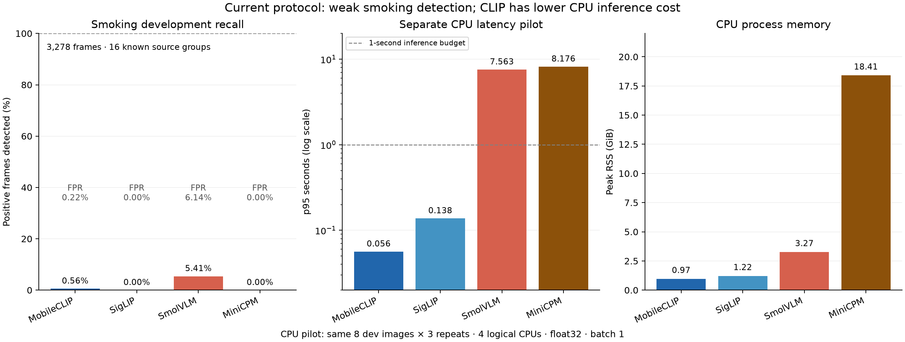

# Evaluation workflow review — 13 October 2026

The repository supports a defensible exploratory comparison of the four pretrained image models on smoking and unattended items. It cannot yet support a validated five-event ranking: three tasks lack event labels, smoking recordings have already been used for development, and unattended-item testing has one positive source sequence per split. The current VadCLIP implementation is a separately supervised smoking adaptation, rather than the original weakly supervised benchmark protocol.

## Dataset audit

The detailed local counts and annotation checks are in [data_readiness_20261013.json](data_readiness_20261013.json). Counts describe downloaded files, including exports and duplicates; they are not independent events.

| Task | Local material | Annotation meaning | Evaluation readiness |
|---|---|---|---|
| Smoking | 4,214 images across two COCO exports | Video export: 3,278 frames with `Smoking` / `Not Smoking` boxes, grouped into 16 camera/day sessions. CCTV export: 936 images, all smoking-positive; `no_vest` does not establish a smoking-negative scene. | Video export supports development comparisons. The 16 known sessions remain development data for the main image benchmark. CCTV needs source genealogy and matched normals before a held-out comparison. |
| Littering | 6,721 images, 7,134 text files | YOLO classes are dropping, dumping, putting-down, throwing, tossing. An action box does not necessarily mean discarding rubbish. | Needs event review and matched normals. Validation labels have no validation images. Train/test class distributions differ substantially. Missing labels must not become negatives. |
| Loitering | 1,675 images, 95 videos, 37 MAT files | Both Roboflow exports contain person boxes. Inspected Avenue MAT files contain uint8 grayscale video volumes (`vol`, 120×160×frames), not reviewed loitering intervals. VIRAT clips need event/track annotation mapping. | Needs recording identity, duration criteria, event intervals and normal passages. |
| Rough sleeping | 224 image files across exports; 112 unique file/RGB hashes | Both pose datasets label laying/standing, with duplicated export sources. Posture alone does not establish sleeping with bedding in a public area. | Needs event review, matched normals and duplicate/source consolidation. |
| Unattended items | 16 raw videos, plus downloaded CAVIAR/ABODA material | CAVIAR reviewed leaving/pickup/walking intervals supply event/control labels. ABODA has videos without reviewed event intervals in this checkout. D2 foreground masks are auxiliary. | Preliminary CAVIAR evaluation: 20 development and 16 test endpoints, with matching past-window sheets. Each split has three source groups and only one positive sequence. |

The literal littering filename audit found 46 images without a matching label and 45 label files without a matching image across train/test. Rename receipts can recover aliases, so these counts identify review candidates rather than proving corruption. Seven empty test label files are not sufficient evidence for general task-specific normals. The test export contains class IDs 0/1; training contains 1/2/3/4.

## What the workflow already did well

- Keeps recording groups together across splits and across frame/window protocols.
- Checks original file hashes, decoded EXIF-corrected RGB pixels and checksum-qualified source moments; rejects conflicting labels and leakage.
- Treats historical inputs as development data and excludes person/action/posture proxies from confirmed event scoring.
- Gives models identical selected cohorts. Includes inference failures and abstentions in categorical quality metrics and shows coverage separately.
- Fits continuous operating thresholds on development data and freezes them for test. Does not invent continuous AUC for VLM label outputs.
- Uses recording-group bootstrap and paired resampling rather than pretending adjacent frames are independent recordings.
- Records model revisions, processors, definitions, image/code hashes, raw responses and experiment settings.

## Changes made

1. Removed forced GPU hiding from resource settings and subprocess launch. Added `--device auto/cpu/cuda/cuda:N` to image adapters and all VadCLIP stages. Explicit CUDA requests fail when unavailable; automatic placement records the CPU fallback.
2. Added dtype selection. Automatic CPU inference remains float32; CUDA generative VLMs use supported bfloat16 or float16. CLIP stays float32 by default. CUDA attention uses SDPA where supported, and measured operations synchronize CUDA before/after timing.
3. Added native CLIP batching and optional concurrent isolated model workers. VLMs remain one input per call. Saved rows distinguish batch-amortized time from single-input latency and preserve input order, predictions and errors.
4. Removed the default accuracy RAM cap, increased the full runner's model timeout to four hours, and retained zero pacing sleeps. Default accuracy threads use the available affinity set; explicit thread counts are per worker. CPU deployment remains a separate mode with one worker, batch size one and configurable resource limits.
5. Removed the hidden preparation cap in `run`: `--per-group 0` retains all confirmed data. Explicit caps remain available for recording-balanced experiments and are recorded as available versus retained counts. Reusing old preparation retains its previous cap.
6. Indexed download rename receipts once per file version. Previously, every original-name lookup parsed a 3 MB receipt and scanned every rename entry. In a live check, smoking collection took 0.61 seconds and littering collection 6.93 seconds, with one receipt parse across over 30,000 lookups. The index invalidates when the receipt changes; ambiguous differing file contents still fail.
7. Expanded CSV/Markdown quality reporting with precision, recall, F1, FPR, AP, AUROC, development-calibrated test points and supervised VadCLIP/baseline results. Resource tables describe their device, batching and concurrent workload separately.
8. Validated reviewed protocol names and whitespace, isolated collector failures, and added configurable VadCLIP weight/cache paths plus the official encoder checksum check.

## Hardware and test scope

[hardware_20261013.json](hardware_20261013.json) records the initial blocker and the working isolated runtime. Host `nvidia-smi` fails with a driver/library mismatch: loaded kernel driver 580.159.03 versus NVML 580.178. The original environment contains CPU-only PyTorch 2.14.1. I downloaded and checksum-verified the [official matching NVIDIA archive](https://download.nvidia.com/XFree86/Linux-x86_64/580.159.03/), extracted its user-space libraries into `data/models/nvidia_runtime`, and installed Torch 2.8.0+cu128 / torchvision 0.23.0 in `.venv-gpu`. CUDA tensor multiplication and real MobileCLIP/SigLIP inference succeeded on the RTX 5000 Ada. The system driver installation and original CPU environment are unchanged.

Initially only 4,275 MiB of the GPU's 32,760 MiB was free. After you freed memory, a host query confirmed 30,115 MiB available and the complete MiniCPM GPU run succeeded. All four image models and the VadCLIP study ran on CUDA. The VLMs used unquantized bfloat16 weights, and the CLIP models used float32. `scripts/evaluate_gpu.sh` selects the matching local libraries only when their version matches the currently loaded kernel module, then launches the separate GPU environment.

The final GPU comparison covers all 3,350 confirmed inputs for each of the four image models: 13,400 measured predictions. All accuracy runs use zero duty-cycle/camera-rate sleeps. GPU throughput measurements remain observational because the models ran in separate jobs on a shared host. The CPU latency pilot ran separately, with a frozen four-core budget and no other evaluation jobs running. Smaller CPU runs remain diagnostic artifacts; they are not the final quality comparison.

## Completed accuracy comparison

The [combined GPU report](../results/gpu_all_models_20261013/report.md) contains the complete four-model results, development-calibrated test points, response diagnostics and the separate VadCLIP study. Its source jobs were [MobileCLIP/SigLIP/SmolVLM plus VadCLIP](../results/gpu_full_accuracy_20261013/report.md) and [MiniCPM](../results/gpu_minicpm_full_accuracy_20261013/report.md). Assembly verifies identical ordered sample identities, image hashes, definitions, package code hashes, metric version and inference settings, and rejects overlapping model names. It recomputes metrics and 2,000 recording-group bootstrap draws from saved predictions. Original inference artifacts remain unchanged.

Each model evaluated 3,278 smoking development frames plus 72 unattended-item frame/window inputs, with one measured quality prediction per input. CLIP batch size was 32; generative VLM calls used one input. The shared input protocol letterboxes to a square with a maximum side of 768 pixels, then applies native model processing. Generation was deterministic with a 64-token budget. No inference failed; SmolVLM returned 14 invalid smoking responses, which remain in the quality denominators.

### Smoking: development evidence

All 3,278 frames come from 16 previously inspected camera/day groups: 1,422 positive and 1,856 normal. These are development scores, not unseen-camera test performance. The table shows raw categorical decisions before continuous-score threshold calibration.

| Model | Precision | Recall | F1 | F1 group CI95 | FPR | AP | AUROC | TP / FP |
| --- | --- | --- | --- | --- | --- | --- | --- | --- |
| MobileCLIP2-S2 | 0.667 | 0.006 | 0.011 | 0.002–0.027 | 0.002 | 0.424 | 0.478 | 8 / 4 |
| SigLIP2-B/16-224 | 0.000 | 0.000 | 0.000 | 0.000–0.000 | 0.000 | 0.443 | 0.512 | 0 / 0 |
| SmolVLM-500M-Instruct | 0.403 | 0.054 | 0.095 | 0.006–0.173 | 0.061 | — | — | 77 / 114 |
| MiniCPM-V 4.0 | 0.000 | 0.000 | 0.000 | 0.000–0.000 | 0.000 | — | — | 0 / 0 |

SmolVLM found 77 of 1,422 smoking-positive frames and produced 114 false positives. MobileCLIP found eight positives with four false positives. SigLIP and MiniCPM classified every smoking frame as normal. The apparent 56.6% accuracy of an always-normal answer reflects class balance; its event recall is zero. A continuous constant-score ranking has AP 0.434, the positive prevalence; the two CLIP AP values are close to that reference. Their paired AP and AUROC intervals include zero difference. The paired SmolVLM-minus-MobileCLIP F1 interval also includes zero (−0.013 to 0.166). These results do not establish a useful detector or a robust deployment winner.

### Unattended items: preliminary source-sequence test

Each test protocol has four positive and 12 normal endpoints, from only three source groups. The frame and six-second past-window protocols use the same endpoint labels; they are not 32 independent events. Raw categorical results:

| Input | Model | Precision | Recall | F1 | FPR | AP | AUROC |
| --- | --- | --- | --- | --- | --- | --- | --- |
| frame | MobileCLIP2-S2 | 0.000 | 0.000 | 0.000 | 0.000 | 0.233 | 0.354 |
| frame | SigLIP2-B/16-224 | 0.000 | 0.000 | 0.000 | 0.000 | 0.189 | 0.167 |
| frame | SmolVLM-500M-Instruct | 0.250 | 1.000 | 0.400 | 1.000 | — | — |
| frame | MiniCPM-V 4.0 | 0.000 | 0.000 | 0.000 | 0.000 | — | — |
| window | MobileCLIP2-S2 | 0.250 | 0.250 | 0.250 | 0.250 | 0.281 | 0.458 |
| window | SigLIP2-B/16-224 | 0.000 | 0.000 | 0.000 | 0.250 | 0.196 | 0.188 |
| window | SmolVLM-500M-Instruct | 0.250 | 1.000 | 0.400 | 1.000 | — | — |
| window | MiniCPM-V 4.0 | 0.000 | 0.000 | 0.000 | 0.000 | — | — |

SmolVLM predicted unattended items on every development and test input. Its test F1 of 0.400 equals the always-anomaly baseline and comes with a 100% false-positive rate. MiniCPM predicted normal on all inputs. MobileCLIP window argmax found one of the four positives and falsely flagged three normal endpoints.

Development-only threshold fitting changes the CLIP operating points as follows. Each development protocol has only 16 normal endpoints; one false positive changes the observed FPR by 6.25 percentage points. A 5% development budget therefore requires zero observed false positives and does not establish a 5% population FPR.

| Input | Model | Dev selection | Threshold | Test precision | Test recall | Test F1 | Test FPR |
| --- | --- | --- | --- | --- | --- | --- | --- |
| frame | MobileCLIP2-S2 | dev_max_f1 | 0.225 | 0.333 | 1.000 | 0.500 | 0.667 |
| frame | MobileCLIP2-S2 | dev_fpr_budget | 0.396 | 0.000 | 0.000 | 0.000 | 0.000 |
| frame | SigLIP2-B/16-224 | dev_max_f1 | -1.926 | 0.000 | 0.000 | 0.000 | 0.417 |
| frame | SigLIP2-B/16-224 | dev_fpr_budget | -0.079 | 0.000 | 0.000 | 0.000 | 0.000 |
| window | MobileCLIP2-S2 | dev_max_f1 | 0.409 | 0.250 | 1.000 | 0.400 | 1.000 |
| window | MobileCLIP2-S2 | dev_fpr_budget | 0.562 | 0.000 | 0.000 | 0.000 | 0.083 |
| window | SigLIP2-B/16-224 | dev_max_f1 | -1.324 | 0.250 | 1.000 | 0.400 | 1.000 |
| window | SigLIP2-B/16-224 | dev_fpr_budget | 0.145 | 0.000 | 0.000 | 0.000 | 0.083 |

At the maximum-development-F1 threshold, MobileCLIP frame recall reaches 1.000 with test FPR 0.667. At the development FPR-budget thresholds, both CLIP models have zero test recall. Contact sheets do not provide a reliable improvement on this small cohort. These endpoints cannot estimate operational alerts/hour, ownership reasoning or event detection delay.

### Development diagnostics

The [short-description CLIP experiment](../results/clip_prompt_dev_20261013/short_descriptions/comparison.csv) used every smoking development frame, CPU float32, and the same images. It changed only the text definitions to “A photo of people doing ordinary activities.” and “A photo of a person smoking a cigarette.” MobileCLIP recall increased to 0.533 and F1 to 0.490, but FPR increased to 0.494 and AP was only 0.460. SigLIP remained always normal. This shows substantial prompt-dependent decision bias; it is not a validated improvement and was not selected using test outcomes.

The [recording-balanced CPU comparison](../results/model_comparison_20261013_v2/report.md) covers 308 inputs and all four models. The [full CLIP CPU run](../results/clip_all_confirmed_20261013_v2/report.md) covers all 3,350 confirmed inputs. They help distinguish sampling and numerical effects, but the uncapped GPU comparison above is the main quality result. Float32 CPU and bfloat16 CUDA VLM decisions should not be assumed identical.

### VadCLIP: supervised offline smoking reanalysis

The GPU study trains on nine source sessions (1,910 frames), selects the checkpoint and operating thresholds on four development sessions (312 frames), and evaluates three test sessions (1,056 frames: 560 positive, 496 normal). This is a different cohort and supervision regime from the zero-shot image benchmark. The selected branch is dual_mean. Its fixed development threshold is 0.738177; it yields TP=290, FP=177, FN=270 and TN=319.

| Branch / feature baseline | Precision | Recall | F1 | FPR | AP | AUROC |
| --- | --- | --- | --- | --- | --- | --- |
| visual | 0.530 | 1.000 | 0.693 | 1.000 | 0.530 | 0.500 |
| align | 0.621 | 0.518 | 0.565 | 0.357 | 0.633 | 0.587 |
| dual_mean | 0.621 | 0.518 | 0.565 | 0.357 | 0.633 | 0.587 |
| dual_max | 0.530 | 1.000 | 0.693 | 1.000 | 0.530 | 0.500 |
| zeroshot | 0.530 | 1.000 | 0.693 | 1.000 | 0.482 | 0.410 |
| linearprobe | 0.529 | 0.971 | 0.685 | 0.978 | 0.544 | 0.487 |

The align/dual_mean branch has some score discrimination (AP 0.633, AUROC 0.587), but a 35.7% FPR at 51.8% recall is not a convincing alert operating point. The visual and dual_max branches collapse to all-positive scores (AUROC 0.500). Their higher F1 of 0.693 is the always-positive baseline, not evidence of better event detection. The linear probe also alarms on nearly all normal frames.

A [development-only learning-rate sweep](../results/vadclip_dev_sweep_20261013/selection.json) tested 1e-5, 1e-4 and 1e-3 on the CPU feature cache. Development dual_mean AP was 0.369, 0.393 and 0.425 respectively; the selected setting remained 1e-3, epoch one. Only the selected candidate was evaluated on its test split. Its test AP was 0.632, close to the GPU run. This small sweep did not find a better setting; it does not exhaust architecture, feature or training choices.

## Resource comparison

### GPU accuracy workload

These are measured smoking-workload values. CLIP throughput uses native batches; VLM throughput uses one input per call and depends on the generated response length. Separate jobs on a shared GPU are not a controlled latency ranking. Peaks below are PyTorch tensor allocations, not total device memory use.

| Model | CUDA dtype | Batch | Active inputs/s | Allocated MiB | Reserved MiB |
| --- | --- | --- | --- | --- | --- |
| MobileCLIP2-S2 | float32 | 32 | 220.00 | 775 | 1018 |
| SigLIP2-B/16-224 | float32 | 32 | 181.71 | 1679 | 1848 |
| SmolVLM-500M-Instruct | bfloat16 | 1 | 6.67 | 1132 | 1232 |
| MiniCPM-V 4.0 | bfloat16 | 1 | 5.93 | 7989 | 8116 |

### CPU latency pilot

The [CPU latency run](../results/cpu_latency_20261013/comparison.csv) used the original CPU environment on an AMD Ryzen Threadripper PRO 7975WX, four fixed logical CPUs (0–3), four Torch threads, float32 weights, one model worker, batch size one, and no pacing sleeps. All four models saw the same eight unattended-item development images. Three measured repeats produced 24 latency observations per model, after three warmups. Image decoding/preprocessing and response parsing are included; model load and warmup are excluded from latency. Peak worker RSS includes loading and warmup.

| Model | p50 seconds | p95 seconds | Peak RSS GiB | Cold load seconds |
| --- | --- | --- | --- | --- |
| MobileCLIP2-S2 | 0.055 | 0.056 | 0.97 | 2.89 |
| SigLIP2-B/16-224 | 0.109 | 0.138 | 1.22 | 2.43 |
| SmolVLM-500M-Instruct | 7.505 | 7.563 | 3.27 | 2.41 |
| MiniCPM-V 4.0 | 8.091 | 8.176 | 18.41 | 4.15 |

Both CLIP models met a one-second sampled-input inference budget in this pilot. The two VLMs did not. This is a small replay on this host; it does not emulate another CPU, account for camera capture/queueing, or predict latency for longer answers and larger native image protocols. The float32 MiniCPM process used about 18.4 GiB RSS; quantized deployment would need its own quality and latency evaluation.



The plot keeps the smoking development operating point separate from the CPU resource pilot. The complete numeric cohort tables are also exported as [model_comparison_20261013.csv](model_comparison_20261013.csv). Per-cohort plots, raw predictions and paired intervals remain in the combined run directory.

## Verification and data-readiness outcome

- All 144 unit/integration tests passed in both the CPU environment and the separate CUDA-enabled environment. Tests cover device placement and token dtypes, batching, AP ties, uncapped preparation, receipt invalidation/collisions, source/pixel leakage, parser behavior and rejection of incompatible report assembly.
- Ruff lint and format checks, shell syntax and `git diff --check` passed.
- The live combined analysis verified 13,400 saved measured predictions against their planned ordered cohorts and recomputed metrics from raw outputs. All 20 model/cohort summaries are successful; no analysis errors remain.
- The [five-task readiness gate](../results/five_task_readiness_20261013/report.md) returned exit code 2 before inference. Missing confirmed littering, loitering and rough-sleeping labels are an explicit data gap, not zero performance. Smoking also lacks a fresh main-benchmark test cohort.

The next comparison needs reviewed event/normal labels and fresh source recordings. Current evidence supports testing CLIP as a low-latency scoring component and investigating crop/temporal protocols on development data; it does not support selecting any present configuration as a five-task deployment detector.

## Remaining limitations and next evaluation

A shared six-second contact sheet provides limited temporal context. It does not establish an operational loitering duration, owner departure/retrieval, event detection delay, alerts/hour or native video understanding. The current MiniCPM adapter bounds slicing to one image slice; small-object quality and native multi-image/video protocols require a separate development experiment. Its publisher supports multi-image/video inputs, so these baseline scores must not be read as a test of its full native video capability ([MiniCPM model card](https://huggingface.co/openbmb/MiniCPM-V-4)). SmolVLM processing is also bounded to 768 pixels here; its publisher documents a larger native resize option ([SmolVLM model card](https://huggingface.co/HuggingFaceTB/SmolVLM-500M-Instruct)). Smoking objects can occupy only a few pixels after whole-scene resizing to CLIP's native input size. A detected-person crop protocol could help, but ground-truth crops are an oracle diagnostic unless the detector and its failures are included.

For all five events, import reviewed positive intervals and task-specific normal controls with recording/camera identity, source genealogy and explicit duration/ownership rules. Use more independent cameras and recordings, freeze prompts/thresholds on development data, and reserve fresh recordings for a final test. The already inspected CAVIAR test set becomes development evidence for future protocol changes.

VadCLIP results must retain the supervised/offline qualification: this implementation uses frame supervision, sparse camera/day sessions, resampling to 256 temporal positions and future context. The [official implementation](https://github.com/nwpu-zxr/VadCLIP) uses a weakly supervised video protocol on UCF-Crime/XD-Violence. Its published dataset results cannot be substituted for smoking, littering, loitering, rough sleeping or unattended-item performance here. The official learning-rate defaults are [2e-5 for UCF-Crime](https://github.com/nwpu-zxr/VadCLIP/blob/main/src/ucf_option.py) and [1e-5 for XD-Violence](https://github.com/nwpu-zxr/VadCLIP/blob/main/src/xd_option.py); this checkout's smoking adaptation defaults to 1e-3, so development-only optimization checks are warranted.

To reproduce the complete available-data accuracy workflow in a new results directory:

```bash
anomaly-eval run --device cuda --per-group 0 --batch-size 32 --vadclip
# On this workspace, use the isolated matching runtime:
scripts/evaluate_gpu.sh run --device cuda --per-group 0 --batch-size 32 --vadclip
```

Use `--workers N` only when the combined models fit VRAM. Use `--require-all-tasks` as a data-readiness gate; it currently stops before inference because the five-task event coverage is incomplete. Measure CPU latency separately with fixed preprocessing, token budget, dtype, threads, one worker and batch size one.
